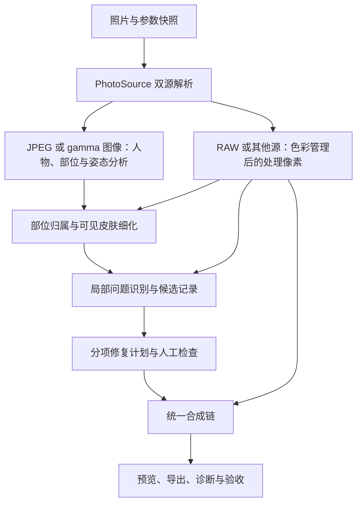

# 人像自动精修总体框架

更新：2026-11-12。本文描述目标架构、当前落地状态和迭代验收；具体使用方式、历史参数与样片记录见 [README](../README.md)。状态标为“规划”的内容尚未进入正式处理链，不能当作现有能力。

## 1. 目标与问题范围

以自然、可控、保留人物特征的批量人像精修为目标。同一套外观目标应按每张照片的曝光、肤色、人物部位与局部问题重新计算；不使用文件名分支、样片固定坐标或逐张隐藏参数。

| 用户反馈 | 对应模块 | 验收重点 |
|---|---|---|
| 260 脸部灰、饱和度不足 | 曝光与肤色协调 | 补光后色度、色相和明暗层次；不以提高全图饱和度代替肤色判断 |
| 372 小黄斑、痘印和鼻部细点残留 | 问题识别、局部修复 | 小点召回、误选与修复残留；不把毛孔、痣和妆容一并清除 |
| 1063 发丝间脸颈、手臂边界不准 | 部位定位、可见皮肤细化 | 漏选、道具误选、发丝混合边界；脸颈与手部归属 |
| 1197 唇部暗红，唇缘尤为明显 | 唇部颜色与局部光影 | 唇内、唇缘分开评估；保留轮廓、唇纹和高光 |

531 已从本轮验收组剔除，相机原片保留。260、372、1063、1197 是固定回归组，不能同时充当训练集和独立效果评测集。

## 2. 系统分层



### 输入与色彩基础：已实现

- `PhotoSource` 解析同名 RAW/JPEG 与符号链接。RAW 提供处理像素，相机 JPEG 提供稳定的语义分析输入；单文件有回退路径。
- 工作空间为扩展线性 Display P3、32 位浮点；颜色比较统一为 Lab D65。禁止直接跨 ICC 比 RGB。
- 所有分析坐标转换到应用 EXIF 方向后的原图空间。修复点使用归一化 Core Image 左下坐标；模型位图通常从上到下，映射必须单独核验。

### 部位定位与皮肤细化：部分实现

当前 `SemanticParser`、`MaskRenderer`、`BodyRegionGuide`、`SkinMaskRefinement` 组合 Vision 人脸／姿态／手部、脸部解析、服装解析和本张肤色。

目标是把“部位在哪里”和“该像素是否为可见裸露皮肤”分开：身体部位分割可能包含手套、指甲、首饰；人物蒙版也包含衣服和道具。被完全遮挡的皮肤没有可处理像素，不作补全。

规划的融合顺序：

1. 语义提供部位候选、人物归属及眼唇／头发／衣服等保护信息。
2. 姿态与手部关键点提供空间先验；低置信度或缺失时降低权重，不能一票否决可靠语义。
3. 从每个部位的高置信度皮肤核心估计局部 Lab 分布，必要时区分受光与阴影。脸和手不强行共用单个肤色中心。
4. 颜色、连通性、图像边缘共同细化候选；肤色相近只能增加证据，不能让选区跨越衣物或连接远处物体。
5. 输出柔边作用权重与不确定区域，供减弱处理和画笔修正。未经校准的权重称为“权重”，不称识别概率。

不要把多个不可靠蒙版全部相乘，否则任一漏选都会被固化；也不要无约束取并集。冲突时要保留来源，按部位与保护规则裁决。细发丝、半透明布料和运动模糊需保留混合像素过渡。

### 局部问题识别：部分实现

当前 `BlemishDetector` 在有效皮肤区域分析局部 Lab 残差、连通尺寸、形状与方向性，并寻找附近干净取样区。红点、深色点是颜色规则，不是痘痘、痣或黑头分类。

本轮新增黄褐色小点候选：以局部 b* 增量和轻微暗差为证据，复用尺寸、方向性、保护区域和干净取样限制。它同样可能识别雀斑、妆容或正常纹理，因此默认不勾选，评分只供排序。

规划中的独立问题包括：点状瑕疵、局部色斑、皮肤光影不均、唇缘暗色与唇内颜色。不能把所有暗像素归为瑕疵，也不能靠放宽同一个阈值承担所有任务。鼻部细点目前仍受保护区限制，尚未实现可靠黑头分类。

### 分项修复：部分实现

| 任务 | 当前方式 | 后续方向 |
|---|---|---|
| 局部纹理异常 | `SpotRepair.texture`：源高频＋目标低频 | 有质量门槛的学习式局部修复 |
| 黄褐色小点 | 本轮 `sampledSkin`：源纹理与颜色＋宽尺度光照补偿，需确认 | 扩展多尺度候选、验证色差与纹理保持 |
| 肤色／曝光 | `AutomaticBase`、参考肤色闭环及身体协调 | 部位局部光照建模，避免阴影强行同色 |
| 局部光影平整 | 现有肤色均匀、柔化提供有限改善 | 独立减淡加深场，保留面部立体结构 |
| 唇色 | 独立唇部蒙版、Lab 亮度／色相／色度与参考目标 | 唇缘与唇内分别估计、渐变融合 |

新色点修复不再原样保留目标低频色斑。取样区提供颜色与纹理，目标／源的宽尺度 Lab 差补偿缓慢光照变化；差值限幅，作用区使用柔边圆盘。取样相似度和保护边界仍需人工检查。该算子没有生成新的身份特征，也不是神经网络修复模型。

## 3. 统一合成与模块契约

正式合成仍以 `ColorEngine.composite` 为唯一像素入口：

**局部修复 → 可选自动基础校正 → 全图调色 → 普通调整图层 → 脸部参考适配与身体协调 → 根据最终肤色计算的自动唇部图层。**

手动唇部图层仍在普通图层阶段。规划中的学习式修复或光影算子先在独立实验验证，再确定插入阶段；不能从预览或 GUI 绕过统一合成链。

当前可复用的数据契约：

- `BlemishAnalysis / BlemishCandidate`：候选类型、逐人人脸索引、规则分数、位置、半径、可选取样修复及警告。候选无可用取样时不能应用。
- `RepairSpot`：本张源／目标坐标、半径与修复模式。旧 JSON 缺少模式时解为原来的纹理修复，旧输出不因新增功能自动改变。
- `Adjustments / AdjustmentLayer`：可保存的参数和蒙版修正；新功能默认值维持旧项目行为。
- `PortraitIntent`：产品外观目标与自动化偏好。批处理逐张重算，未确认的深色／黄褐色候选不进入自动修复。

后续增加统一的分析快照时，应记录：输入内容标识、方向和尺寸、分析模型／算法版本、参数、人物归属、部位权重、保护区域、候选与跳过原因。现在只存在分散的缓存、报告和参数快照，尚无统一快照类型。模型版本或输入变化必须使缓存失效。

候选归照片所有；预设只保存偏好，不保存坐标；同步保留接收照片自己的修复和画笔；异步结果须校验照片和修复快照；批处理取消与撤销沿用现有事务提交。

## 4. 模型与数据接入

研究入口是 `Scripts/portrait-research/`，独立环境、权重校验和原生输出留存。实验结果目录为 `成片/开源算法对比-2026-11-12/`。

| 候选 | 已观察到的结果 | 正式接入状态 |
|---|---|---|
| SegFace Mobile／Swin | 脸颈仍有漏选与道具误选，未全面优于现有解析 | 仅研究 |
| Sapiens2-0.4B | 手臂覆盖更完整；部位类别不等于裸露皮肤 | 仅研究，需融合实验和部署评估 |
| ModelScope 局部修复 | 本轮权重对 372 残留黄斑／鼻部细点改善有限 | 仅研究，不直接替换正式算子 |
| RetouchFormer | 未取得权重，未推理 | 尚未验证 |

数据用途要分开：CelebAMask-HQ／LaPa 可研究脸部部位，FFHQR 可研究成对精修，ACNE04v2 可研究病灶定位，PPR10K 可研究人像调色。它们不共同提供“全身裸露皮肤＋瑕疵类别＋自然精修真值”。本轮未下载完整训练集，也未训练模型。

采用前逐项核查代码、权重、数据及原始图片授权，保存明确来源和版本；非商业／研究限制不能因代码开源而忽略。未经确认的授权和缺失权重属于接入条件未满足，不宣称可商用。

接入门槛：严格权重加载；输入归一化与类别顺序正确；原生输出独立检查；CPU/GPU 精度一致性；原图／原生裁切质量；延迟和峰值内存；Core ML 或其他部署路径验证；依赖和授权记录。数值一致性不等于视觉质量。

## 5. 验收设计

每次行为改动按影响范围验证，不用单张“看起来更好”替代整体结论。

- **定位**：有人工真值后按脸、颈、手分别统计覆盖、误选与边界；额外单列发丝、阴影、肤色道具和衣物。当前没有这些真值，不报告准确率。
- **识别**：人工标注应修／保留／不确定区域，按问题种类记录召回、误选和取样可用率。候选数量增加不代表准确率提升。
- **修复**：原生尺寸检查残留、重复纹理、糊化、色块与光晕；测局部 Lab 异常是否下降。自动测量不能证明审美正确。
- **融合**：局部作用区外无损像素保持；边缘没有新台阶；光照渐变和高光有保留。JPEG 的编码差异与算法影响分别检查。
- **工程**：旧项目兼容、修复模式往返、人物归属、撤销／同步、坐标转换、预览导出一致性、原片完整性。

最小部位融合对比：现有基线、语义单独、语义＋颜色、语义＋颜色＋姿态。使用相同输入与评价区域，先冻结参数，再在其他拍摄组验证。记录错误类型，而不是仅展示成功照片。

## 6. 实施顺序与本轮边界

1. **本轮落地**：黄褐色小点候选＋可确认的颜色／纹理修复；接入现有检查面板、项目保存、撤销和导出，补充合成图回归及真实照片诊断。
2. **下一阶段**：部位分析快照与冲突诊断；1063 分割融合对比，建立可见皮肤人工真值；通过后再替换正式蒙版。
3. **随后**：1197 唇缘暗色的独立估计与柔边修正，验证肤唇边界和嘴角保护。
4. **模型阶段**：扩大样本、完成数据与部署审核，再引入学习式瑕疵或光影模块。

本轮没有新增黑头分类、全自动祛黄斑、学习式减淡加深或新分割模型。黄褐色候选属于可人工确认的规则能力，不代表 372 的全部问题已经解决。

### 本轮复现与实片结果

```sh
# 输出候选 JSON、参数快照、面部对照、原生局部 PNG 和原片哈希；不修改项目。
Scripts/check-color-spots.sh --output .build/color-spot-qa-2026-11-12 \
  100MSDCF/DSC00260.JPG 100MSDCF/DSC00372.JPG \
  100MSDCF/DSC01063.JPG 100MSDCF/DSC01197.JPG

swift test --disable-sandbox --filter 'ColorSpotTests|BlemishDetectionTests|testBlemishReviewIsPhotoLocalAndUndoable'
```

诊断基线使用 RAW 原始显影，不叠加快速修图，以隔离本次局部修复。372 检出 8 个红点和 2 个黄褐色点，两个黄褐色点均有可用取样；260、1063、1197 分别检出 0 个黄褐色点。候选数量不是准确率。对照图右列是黄褐色候选全选演示，不表示用户已确认，也不进入用户项目。

372 两处原生局部对照可见色点减淡；其余脸部细点仍有残留。以局部核心与周围环形区的平均 Lab 计算，ΔE76 分别由约 8.16／5.82 降到 1.17／0.55，仅作为这两处的局部颜色核验，不代表识别准确率或整体精修质量。测量保存于上述目录的 `局部色差测量.json`。四张的源 RAW/JPEG 处理前后 SHA-256 一致。

工程回归覆盖：局部色差下降与纹理保留、作用区外像素、宽暖色区域与线条排除、保护区、裁切及非零原点坐标、旧 JSON 与新模式保存、预览／16 位 TIFF 一致性，以及人工确认后的撤销与同步归属。

## 7. 设计依据

商业工具只作为功能分工参考，其公开功能不能证明内部网络结构：[像素蛋糕人像细节说明](https://wiki.pixcakeai.com/guide/9403.html)、[皮肤调整](https://www.pixcakeai.com/guide/32508)、[Retouch4me 模块 API](https://retouch4.me/docs/cloud_retouching_api/en/)。研究来源和实测限制见 [实验入口](../Scripts/portrait-research/README.md)。
